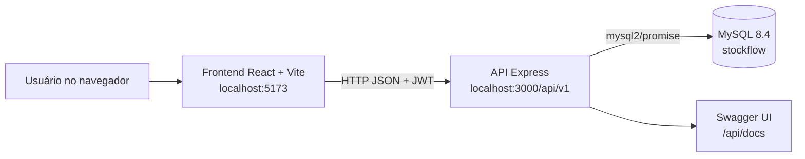
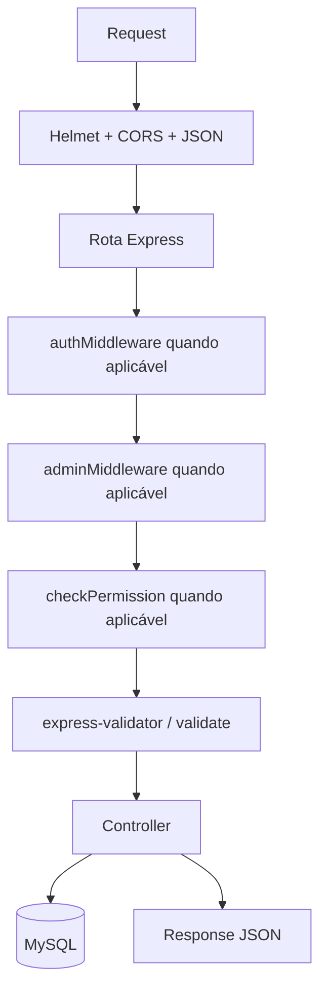
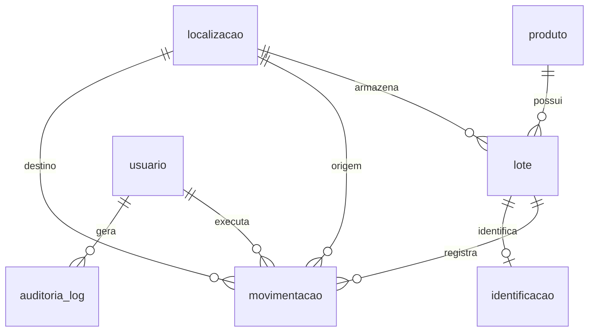
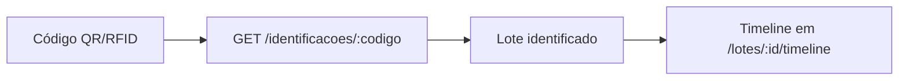
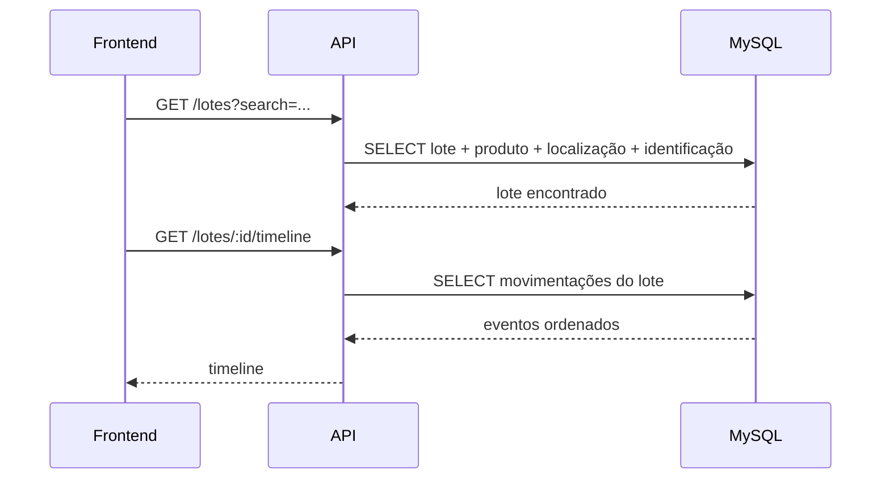
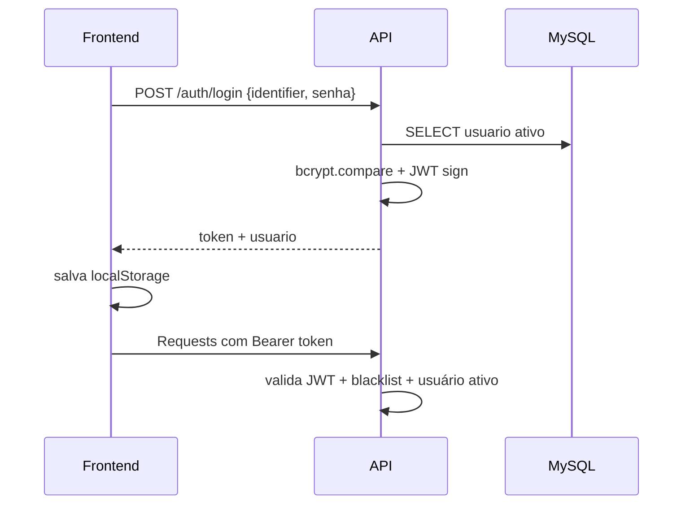
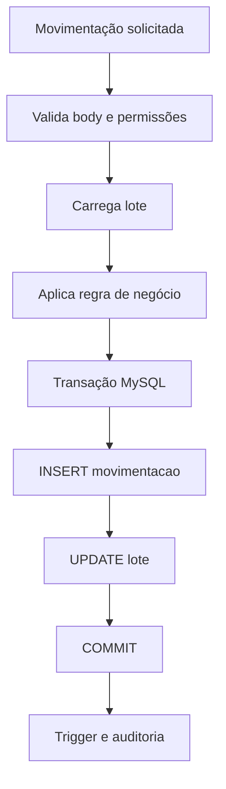

# Arquitetura do StockFlow

## Visão Geral

StockFlow é uma aplicação web full-stack com frontend React, API Express e banco MySQL.



## Componentes

| Componente | Caminho | Responsabilidade |
|---|---|---|
| SPA React | `stockflow-frontend/src` | Telas, rotas, autenticação no cliente, chamadas HTTP e design system |
| API Express | `stockflow-api/src` | Rotas REST, autenticação, autorização, validações e regras transacionais |
| Banco MySQL | `database/` | Schema, constraints, triggers, seeds e scripts complementares |
| Documentação API | `stockflow-api/src/config/swagger.js` | Swagger UI em `/api/docs` |

## Frontend

### Estrutura

```text
stockflow-frontend/src/
├── api/axios.js
├── components/Layout.jsx
├── components/PainelAtalhos.jsx
├── context/AuthContext.jsx
├── context/ToastContext.jsx
├── hooks/useKeyboardShortcuts.js
├── pages/
└── styles/
```

### Rotas SPA

As rotas ficam em `stockflow-frontend/src/App.jsx`.

- Pública: `/login`.
- Privadas: `/dashboard`, `/produtos`, `/lotes`, `/mapa`, `/entrada`, `/saida`, `/transferencia`, `/historico`, `/rastreabilidade`, `/alertas`, `/relatorios`, `/inventario`, `/perfil`.
- Administrativas: `/auditoria`, `/usuarios`, `/ajuste`, `/sap`.

`PrivateRoute` exige usuário autenticado. `AdminRoute` exige `user.isAdmin`.

### Cliente HTTP

`src/api/axios.js` usa:

- `baseURL: import.meta.env.VITE_API_URL || 'http://localhost:3000/api/v1'`.
- Interceptor de request para `Authorization: Bearer <token>`.
- Interceptor de response que limpa `localStorage` e redireciona para `/login` em HTTP 401.

### Design System

O frontend usa `src/styles/tokens.css` e `src/styles/app.css` como base visual. As telas usam componentes React com CSS global, cards, tabelas, badges, drawers e KPIs.

## Backend

### Bootstrap

`stockflow-api/src/app.js` configura:

- `dotenv`.
- `express-async-errors`.
- `helmet`.
- CORS com `FRONTEND_URL`.
- `express.json`.
- Swagger UI.
- Rotas sob `/api/v1`.
- Health check.
- Handler global de erro.



### Rotas Montadas

| Prefixo | Arquivo |
|---|---|
| `/api/v1/auth` | `routes/auth.routes.js` |
| `/api/v1/produtos` | `routes/produtos.routes.js` |
| `/api/v1/lotes` | `routes/lotes.routes.js` |
| `/api/v1/movimentacoes` | `routes/movimentacoes.routes.js` |
| `/api/v1/localizacoes` | `routes/localizacoes.routes.js` |
| `/api/v1/usuarios` | `routes/usuarios.routes.js` |
| `/api/v1/identificacoes` | `routes/identificacoes.routes.js` |
| `/api/v1/auditoria` | `routes/auditoria.routes.js` |
| `/api/v1/dashboard` | `routes/dashboard.routes.js` |
| `/api/v1/inventarios` | `routes/inventarios.routes.js` |
| `/api/v1/inventario` | `routes/inventario.routes.js` |
| `/api/v1/sap` | `routes/sap.routes.js` |

## Banco

O script principal `database/setup.sql` cria:

- `localizacao`
- `produto`
- `usuario`
- `lote`
- `movimentacao`
- `identificacao`
- `auditoria_log`

Também cria triggers:

- `trg_audit_movimentacao_insert`
- `trg_audit_lote_update`
- `trg_audit_usuario_insert`



Observação: o código atual referencia a tabela `inventario`, mas o schema principal não a cria. Isso deve ser tratado antes de considerar o setup reproduzível em ambiente limpo.

## RFID e QR Code

O suporte existente está modelado pela tabela `identificacao`:

- `tipo`: `QR Code` ou `RFID`.
- `codigo`: valor único do identificador.
- `id_lote`: lote vinculado, com restrição de unicidade.

Fluxo real:



## Fluxo de Rastreabilidade



## Fluxo de Autenticação



Detalhes reais:

- Login aceita `identifier`, que pode ser e-mail ou código numérico de usuário.
- `POST /auth/login` usa `loginLimiter`.
- Logout adiciona token à blacklist em memória.
- Em requisições autenticadas, `authMiddleware` recarrega usuário ativo do banco.

## Fluxo de Movimentações



Operações transacionais:

- Entrada: incrementa `lote.quantidade`.
- Saída: decrementa `lote.quantidade`, bloqueia saída acima do disponível e bloqueia lote vencido/bloqueado.
- Transferência: altera `lote.id_localizacao`.
- Ajuste: altera quantidade para novo valor, exige administrador.
- Inventário finalizado em `/inventario/:id/finalizar`: grava movimentações tipo `inventario` para divergências e ajusta lotes.

## Estrutura de Módulos

| Módulo | Frontend | API principal |
|---|---|---|
| Dashboard | `Dashboard.jsx` | `/dashboard/*` |
| Produtos | `Produtos.jsx` | `/produtos` |
| Lotes | `Lotes.jsx` | `/lotes` |
| Mapa | `MapaArmazem.jsx` | `/localizacoes`, `/lotes` |
| Entrada | `Entrada.jsx` | `/movimentacoes/entrada` |
| Saída | `Saida.jsx` | `/movimentacoes/saida` |
| Transferência | `Transferencia.jsx` | `/movimentacoes/transferencia` |
| Histórico | `Historico.jsx` | `/movimentacoes` |
| Rastreabilidade | `Rastreabilidade.jsx` | `/lotes`, `/lotes/:id/timeline` |
| Alertas | `AlertasVencimento.jsx` | `/lotes/vencendo`, `/lotes/:id/bloquear` |
| Inventário | `Inventario.jsx` | `/inventario` |
| Relatórios | `Relatorios.jsx` | `/movimentacoes`, `/lotes`, `/inventarios` |
| Usuários | `Usuarios.jsx` | `/usuarios` |
| Auditoria | `Auditoria.jsx` | `/auditoria` |
| SAP | `IntegracaoSAP.jsx` | `/sap/importar-produtos`, `/sap/importar-json` |

## Escalabilidade

Pontos já favoráveis:

- API stateless para requisições autenticadas por JWT.
- Pool MySQL com `connectionLimit`.
- SQL direto, sem camada ORM.
- Frontend com build estático.

Pontos a resolver para escalar:

- Blacklist de JWT é in-memory; múltiplas instâncias exigem Redis ou tabela persistente.
- Setup limpo do banco precisa incorporar a criação de `inventario`.
- Listagens extensas devem manter paginação consistente.
- Auditoria por texto/JSON em `auditoria_log` pode exigir estrutura adicional para buscas avançadas.
- Exportações grandes no frontend podem impactar memória do navegador.
