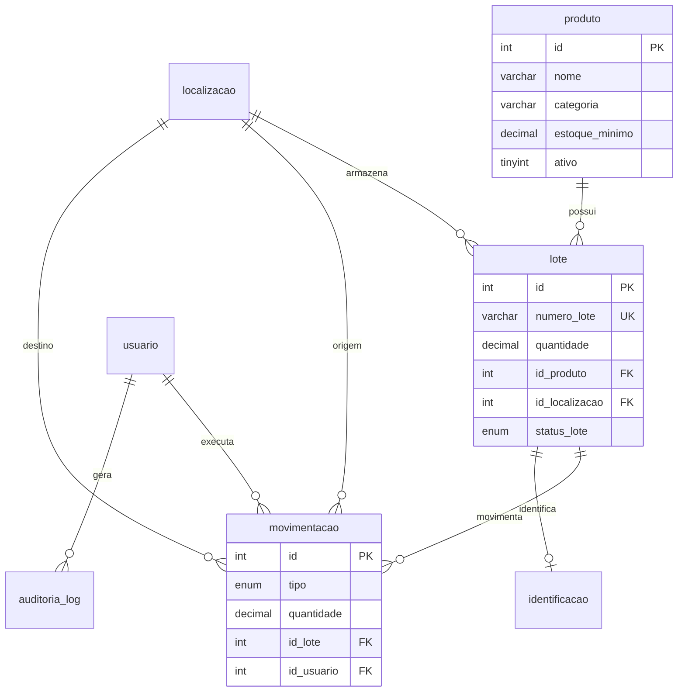

# Database Documentation — StockFlow

Base analisada: arquivos SQL em `database/`, principalmente `database/setup.sql`.

## Banco

- SGBD: MySQL 8.4.
- Database: `stockflow`.
- Charset: `utf8mb4`.
- Engine: InnoDB.

## Tabelas do `setup.sql`

### `localizacao`

| Campo | Tipo | Chave/Constraint | Observação |
|---|---|---|---|
| `id` | INT | PK, AUTO_INCREMENT | Identificador |
| `corredor` | VARCHAR(10) | NOT NULL | Código do corredor |
| `nivel` | INT | NOT NULL | Nível |
| `posicao` | INT | NOT NULL | Posição |
| `descricao` | VARCHAR(255) | NULL | Descrição operacional |
| `criado_em` | DATETIME | DEFAULT NOW() | Criação |

### `produto`

| Campo | Tipo | Chave/Constraint | Observação |
|---|---|---|---|
| `id` | INT | PK, AUTO_INCREMENT | Identificador |
| `nome` | VARCHAR(255) | NOT NULL | Nome do produto |
| `categoria` | VARCHAR(100) | NOT NULL | Categoria |
| `descricao` | TEXT | NULL | Descrição |
| `unidade_medida` | VARCHAR(20) | NOT NULL | Unidade |
| `estoque_minimo` | DECIMAL(10,3) | DEFAULT 0 | Mínimo operacional |
| `ativo` | TINYINT(1) | DEFAULT 1 | Soft delete |
| `criado_em` | DATETIME | DEFAULT NOW() | Criação |
| `atualizado_em` | DATETIME | DEFAULT NOW() ON UPDATE NOW() | Atualização |

Script complementar:

- `database/feature_inventory_sap_permissions.sql` adiciona `sku_sap VARCHAR(40) NULL`.

### `usuario`

| Campo | Tipo | Chave/Constraint | Observação |
|---|---|---|---|
| `id` | INT | PK, AUTO_INCREMENT | Identificador |
| `nome` | VARCHAR(255) | NOT NULL | Nome |
| `email` | VARCHAR(255) | UNIQUE, NOT NULL | Login por e-mail |
| `senha_hash` | VARCHAR(255) | NOT NULL | Hash bcrypt |
| `perfil` | ENUM('administrador','operador') | DEFAULT 'operador' | Perfil |
| `ativo` | TINYINT(1) | DEFAULT 1 | Usuário ativo |
| `criado_em` | DATETIME | DEFAULT NOW() | Criação |

Script complementar:

- `database/feature_inventory_sap_permissions.sql` adiciona `permissoes JSON NULL`.

### `lote`

| Campo | Tipo | Chave/Constraint | Observação |
|---|---|---|---|
| `id` | INT | PK, AUTO_INCREMENT | Identificador |
| `numero_lote` | VARCHAR(100) | UNIQUE, NOT NULL | Código do lote |
| `data_fabricacao` | DATETIME | DEFAULT NOW() | Fabricação |
| `data_validade` | DATETIME | NULL | Validade |
| `quantidade` | DECIMAL(10,3) | CHECK >= 0 | Quantidade atual |
| `id_produto` | INT | FK `produto.id` | Produto |
| `id_localizacao` | INT | FK `localizacao.id` | Localização atual |
| `status_lote` | ENUM('ativo','vencido','bloqueado','quarentena','finalizado') | DEFAULT 'ativo' | Status |
| `data_bloqueio` | DATETIME | NULL | Data de bloqueio |
| `motivo_bloqueio` | TEXT | NULL | Motivo |
| `criado_em` | DATETIME | DEFAULT NOW() | Criação |
| `atualizado_em` | DATETIME | DEFAULT NOW() ON UPDATE NOW() | Atualização |

### `movimentacao`

| Campo | Tipo | Chave/Constraint | Observação |
|---|---|---|---|
| `id` | INT | PK, AUTO_INCREMENT | Identificador |
| `tipo` | ENUM('entrada','saida','transferencia','ajuste','inventario') | NOT NULL | Tipo |
| `data_movimentacao` | DATETIME | DEFAULT NOW() | Data |
| `quantidade` | DECIMAL(10,3) | CHECK > 0 | Quantidade movimentada |
| `id_lote` | INT | FK `lote.id` | Lote |
| `id_usuario` | INT | FK `usuario.id` | Usuário |
| `id_localizacao_origem` | INT | FK `localizacao.id`, NULL | Origem |
| `id_localizacao_destino` | INT | FK `localizacao.id`, NULL | Destino |
| `motivo_movimentacao` | VARCHAR(255) | NULL | Motivo |
| `observacao` | TEXT | NULL | Observação |
| `status` | ENUM('pendente','concluida','cancelada') | DEFAULT 'pendente' | Status |
| `criado_em` | DATETIME | DEFAULT NOW() | Criação |

### `identificacao`

| Campo | Tipo | Chave/Constraint | Observação |
|---|---|---|---|
| `id` | INT | PK, AUTO_INCREMENT | Identificador |
| `tipo` | ENUM('QR Code','RFID') | NOT NULL | Tipo de identificação |
| `codigo` | VARCHAR(500) | UNIQUE, NOT NULL | Código lido |
| `id_lote` | INT | FK `lote.id`, UNIQUE | Um código por lote |
| `criado_em` | DATETIME | DEFAULT NOW() | Criação |

### `auditoria_log`

| Campo | Tipo | Chave/Constraint | Observação |
|---|---|---|---|
| `id` | INT | PK, AUTO_INCREMENT | Identificador |
| `tabela_afetada` | VARCHAR(100) | NOT NULL | Tabela auditada |
| `operacao` | ENUM('INSERT','UPDATE','DELETE','LOGIN','AJUSTE','BLOQUEIO') | NOT NULL | Operação |
| `valor_anterior` | TEXT | NULL | Estado anterior |
| `valor_novo` | TEXT | NULL | Novo estado |
| `id_usuario` | INT | FK `usuario.id`, NULL | Usuário |
| `data_hora` | DATETIME | DEFAULT NOW() | Data/hora |
| `ip_usuario` | VARCHAR(45) | NULL | IP |

## Relacionamentos

## Triggers

| Trigger | Evento | Tabela | Efeito |
|---|---|---|---|
| `trg_audit_movimentacao_insert` | AFTER INSERT | `movimentacao` | Insere registro em `auditoria_log` |
| `trg_audit_lote_update` | AFTER UPDATE | `lote` | Audita mudança de quantidade/status |
| `trg_audit_usuario_insert` | AFTER INSERT | `usuario` | Audita criação de usuário |

## Índices e Chaves

Índices explícitos observados no `setup.sql`:

- Primary keys em todas as tabelas.
- `usuario.email` único.
- `lote.numero_lote` único.
- `identificacao.codigo` único.
- `identificacao.id_lote` único.
- Foreign keys entre lote/produto/localização, movimentação/lote/usuário/localizações, identificação/lote e auditoria/usuário.

Não foram encontrados `CREATE INDEX` explícitos no `setup.sql`.

## Constraints

- `lote.quantidade >= 0`.
- `movimentacao.quantidade > 0`.
- Enums em `usuario.perfil`, `lote.status_lote`, `movimentacao.tipo`, `movimentacao.status`, `identificacao.tipo` e `auditoria_log.operacao`.

## Divergência Importante: `inventario`

O código atual consulta e grava a tabela `inventario` em:

- `stockflow-api/src/routes/inventario.routes.js`
- `stockflow-api/src/routes/inventarios.routes.js`
- `stockflow-api/src/controllers/inventarios.controller.js`
- `stockflow-frontend/src/pages/Inventario.jsx`
- `stockflow-frontend/src/pages/Relatorios.jsx`

Mas `database/setup.sql` não cria essa tabela.

O arquivo `database/feature_inventory_sap_permissions.sql` contém:

- `ALTER TABLE inventario ADD COLUMN IF NOT EXISTS itens JSON`
- `total_divergencias`
- `total_itens`
- `etapa`

Conclusão: a estrutura de `inventario` não está reproduzível a partir do schema principal. A documentação não deve listar campos definitivos da tabela `inventario` como schema garantido até que exista um `CREATE TABLE` real no repositório.
