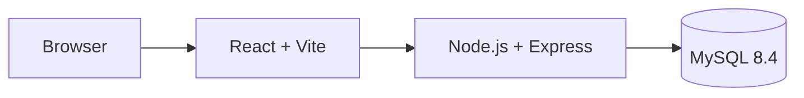

# StockFlow — Apresentação Acadêmica

## 1. Problema

Empresas com estoque físico precisam controlar lotes, validade, localização e movimentações. Em operações baseadas em planilhas, a rastreabilidade fica frágil e a tomada de decisão depende de dados desatualizados.

Pontos críticos:

- Falta de rastreabilidade por lote.
- Dificuldade em localizar produtos fisicamente.
- Risco de vencimento e desperdício.
- Falta de trilha de auditoria.
- Baixa visibilidade operacional.

## 2. Solução

StockFlow é um sistema WMS web para gestão de estoque com:

- Controle de produtos e lotes.
- Localizações físicas.
- Movimentações transacionais.
- Rastreabilidade por lote.
- Identificação por QR Code/RFID.
- Alertas e dashboard.
- Auditoria.
- Integração SAP por JSON.

## 3. Objetivos

- Centralizar o controle de estoque.
- Reduzir divergências operacionais.
- Melhorar rastreabilidade.
- Apoiar decisões com indicadores.
- Registrar operações com usuário responsável.
- Facilitar auditoria.

## 4. Tecnologias

Frontend:

- React 18.
- Vite.
- React Router.
- Axios.
- CSS tokens e Tailwind CSS.

Backend:

- Node.js.
- Express.
- JWT.
- Helmet.
- express-validator.
- express-rate-limit.

Banco:

- MySQL 8.4.
- Triggers.
- Constraints.
- SQL direto via `mysql2/promise`.

## 5. Arquitetura

Características:

- SPA no frontend.
- API REST.
- Autenticação JWT.
- Banco relacional.
- Auditoria em aplicação e banco.

## 6. Funcionalidades

- Dashboard operacional.
- Produtos.
- Lotes.
- Entrada de estoque.
- Saída de estoque.
- Transferência.
- Inventário.
- Mapa do armazém.
- Rastreabilidade.
- Alertas de vencimento.
- Relatórios.
- Usuários e permissões.
- Auditoria.
- Integração SAP.

## 7. Diferenciais

- Controle por lote.
- Timeline de movimentações.
- Bloqueio de lote.
- Permissões customizadas.
- Dashboard analítico.
- Triggers de auditoria.
- Integração SAP por JSON.
- Interface profissional para operação.

## 8. Benefícios

- Maior controle de estoque.
- Consulta rápida de lotes.
- Menor risco de movimentação indevida.
- Melhor visibilidade de vencimentos.
- Auditoria das operações.
- Base para evolução para operação real.

## 9. Limitações e Próximos Passos

Limitações reais:

- O schema principal ainda não cria a tabela `inventario`, apesar de o código depender dela.
- Não há testes automatizados.
- A dependência `xlsx` possui vulnerabilidade alta sem fix disponível no `npm audit`.

Próximos passos:

- Corrigir schema de inventário.
- Adicionar testes.
- Revisar exportação/importação baseada em `xlsx`.
- Evoluir deploy e CI.
- Persistir blacklist JWT fora da memória.

## 10. Conclusão

StockFlow demonstra uma solução full-stack para gestão inteligente de estoque, com foco em rastreabilidade, controle operacional e auditoria. O projeto integra frontend profissional, API REST e banco relacional, formando uma base sólida para evolução acadêmica e técnica.
