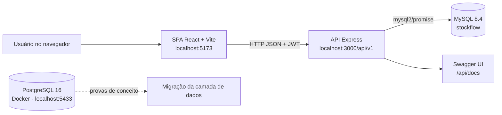

<div align="center">

# StockFlow

**Gestão de estoque com rastreabilidade por lote para a Arte Trigo**

WMS web para controle de lotes, localizações físicas, movimentações transacionais e auditoria de operações.


-4169E1?logo=postgresql&logoColor=white)


Projeto Integrador · UniEVANGÉLICA · 2026

</div>

---

## Sumário

- [Sobre o projeto](#sobre-o-projeto)
- [Funcionalidades](#funcionalidades)
- [Arquitetura](#arquitetura)
- [Tecnologias](#tecnologias)
- [Estrutura do repositório](#estrutura-do-repositório)
- [Como executar](#como-executar)
- [Banco de Dados](#banco-de-dados)
- [Banco PostgreSQL (4º período)](#banco-postgresql-4º-período)
- [Perfis e permissões](#perfis-e-permissões)
- [Regras de negócio aplicadas](#regras-de-negócio-aplicadas)
- [API](#api)
- [Segurança](#segurança)
- [Limitações conhecidas e roadmap](#limitações-conhecidas-e-roadmap)
- [Documentação complementar](#documentação-complementar)
- [Equipe](#equipe)

---

## Sobre o projeto

A **Arte Trigo** é uma empresa de alimentos congelados de Goiás que trabalha com produtos perecíveis, armazenados em câmaras frias e controlados por lote e validade. O StockFlow substitui controles manuais e planilhas por um sistema único que mostra **onde está cada lote, quanto existe, quem movimentou e quando**.

O sistema atual é um protótipo funcional composto por:

- uma SPA em **React + Vite**;
- uma API REST em **Node.js/Express**, com SQL direto via `mysql2/promise`;
- um banco **MySQL 8.4** com constraints e triggers de auditoria.

No 4º período, o projeto também valida a migração da camada de dados para **PostgreSQL 16**, com provas de conceito de auditoria em JSONB e controle de concorrência.

## Funcionalidades

| Área | O que o sistema faz |
|---|---|
| **Dashboard** | KPIs, movimentações recentes, alertas pendentes, ocupação por corredor, curva ABC, rupturas, top produtos, saúde do estoque e distribuição por categoria, com exportação em PDF e planilha |
| **Produtos** | Cadastro, edição, listagem e inativação, com estoque mínimo e unidade de medida |
| **Lotes** | Cadastro, bloqueio/desbloqueio com motivo, lotes vencendo, lotes abaixo do mínimo e timeline completa |
| **Mapa do Armazém** | Visão das posições cadastradas (corredor, nível e posição) e dos lotes em cada uma |
| **Movimentações** | Entrada, saída, transferência entre posições e ajuste de estoque, todas em transação |
| **Inventário rotativo** | Contagem por corredor em etapas: iniciado → em contagem → confirmado → finalizado |
| **Rastreabilidade** | Histórico de um lote do recebimento à expedição |
| **Identificação** | Vínculo de QR Code ou RFID a um lote e leitura para localizar o lote |
| **Alertas de vencimento** | Lotes próximos do vencimento, classificados como críticos (até 15 dias) ou em alerta (até 30 dias) |
| **Relatórios** | Relatórios operacionais com exportação em CSV |
| **Usuários** | Gestão de contas, perfis e permissões customizadas por módulo |
| **Auditoria** | Consulta de logs de operações por lote e por usuário |
| **Integração SAP** | Importação de produtos a partir de JSON |

A interface também tem busca global, tema claro/escuro e atalhos de teclado: `F1`–`F8` para navegar, e `Ctrl+N`, `Ctrl+E`, `Ctrl+S` e `Ctrl+T` para abrir as operações mais usadas. `Ctrl+/` mostra o painel de atalhos.

## Arquitetura



- O **frontend** guarda a sessão, protege rotas por perfil (`PrivateRoute` e `AdminRoute`) e envia o JWT no cabeçalho `Authorization`.
- A **API** valida entradas com `express-validator`, aplica autenticação, autorização por perfil e permissão, e executa as operações de estoque em transação.
- O **banco** garante integridade com chaves estrangeiras e `CHECK`, e grava a auditoria por triggers em `movimentacao`, `lote` e `usuario`.

## Tecnologias

| Camada | Tecnologias |
|---|---|
| Frontend | React 18, Vite 8, React Router 6, Axios, Tailwind CSS, design tokens em CSS, Lucide React |
| Gráficos | SVG próprio nas telas |
| Exportação | `xlsx`, `jspdf`, `html2canvas` |
| Backend | Node.js, Express 4, JWT, bcrypt, Helmet, CORS, express-validator, express-rate-limit |
| Banco (protótipo) | MySQL 8.4, InnoDB, triggers, constraints, SQL direto |
| Banco (4º período) | PostgreSQL 16 em Docker Compose, triggers PL/pgSQL, JSONB |
| Documentação da API | Swagger UI em `/api/docs` |

## Estrutura do repositório

```text
stock-flow/
├── database/
│   ├── setup.sql                              esquema completo, triggers e seed
│   ├── feature_inventory_sap_permissions.sql  migração de bancos antigos
│   ├── triggers.sql, fix_*.sql                scripts complementares
│   ├── seed_*.sql                             dados de demonstração
│   └── postgres/
│       ├── init/                              esquema, triggers e papéis do PostgreSQL 16
│       └── poc/                               provas de conceito 1 e 2
├── docs/
├── stockflow-api/
│   └── src/
│       ├── app.js
│       ├── config/          conexão MySQL e Swagger
│       ├── controllers/
│       ├── middleware/      autenticação, perfil, permissões e auditoria
│       ├── middlewares/     rate limit e validação
│       └── routes/
├── stockflow-frontend/
│   └── src/
│       ├── api/             cliente Axios
│       ├── components/      layout, atalhos, leitura RFID
│       ├── context/         autenticação e notificações
│       ├── hooks/
│       ├── pages/           18 telas
│       └── styles/          design tokens
├── docker-compose.yml       PostgreSQL 16 das provas de conceito
├── .env.example             variáveis do Docker Compose
└── package.json             execução conjunta de API e frontend
```

## Como executar

### Pré-requisitos

- Node.js 20.19 ou superior (exigência do Vite 8) e npm;
- MySQL 8.4;
- Docker com Docker Compose, apenas para o ambiente PostgreSQL.

### 1. Clonar e instalar

```bash
git clone https://github.com/ghcodev/stock-flow.git
cd stock-flow

npm install
cd stockflow-api && npm install
cd ../stockflow-frontend && npm install
cd ..
```

### 2. Criar o banco

```bash
mysql -u root -p < database/setup.sql
```

Detalhes na seção [Banco de Dados](#banco-de-dados).

### 3. Configurar as variáveis de ambiente

API (`stockflow-api/.env`, a partir de `stockflow-api/.env.example`):

```env
DB_HOST=localhost
DB_PORT=3306
DB_USER=root
DB_PASS=sua_senha
DB_NAME=stockflow
JWT_SECRET=troque-por-uma-string-aleatoria-de-64-chars-minimo
JWT_EXPIRES_IN=8h
PORT=3000
ALLOWED_ORIGINS=http://localhost:5173
NODE_ENV=development
```

A API não sobe sem `JWT_SECRET`, `DB_HOST`, `DB_NAME`, `DB_USER` e `DB_PASS`, e exige `JWT_SECRET` com pelo menos 32 caracteres. Para gerar um segredo: `openssl rand -base64 64`.

Frontend (`stockflow-frontend/.env`):

```env
VITE_API_URL=http://localhost:3000/api/v1
```

### 4. Rodar

```bash
npm run dev
```

O comando sobe API e frontend juntos. Para rodar separadamente, use `npm run dev` dentro de `stockflow-api` e de `stockflow-frontend`.

| Serviço | Endereço |
|---|---|
| Frontend | http://localhost:5173 |
| API | http://localhost:3000/api/v1 |
| Swagger | http://localhost:3000/api/docs |
| Health check | http://localhost:3000/api/v1/health |

### 5. Entrar no sistema

O login usa o **código do operador** (o `id` do usuário) e a senha. O `setup.sql` cria oito usuários de exemplo com a senha `Admin@1234`:

| Código | Usuário | Perfil |
|---|---|---|
| 1 | Carlos Eduardo Matos | Administrador |
| 2 | Fernanda Lima | Administrador |
| 3 a 8 | Equipe de câmara fria, conferência, separação e expedição | Operador |

> Essas credenciais servem apenas para desenvolvimento e demonstração. Troque as senhas antes de qualquer uso real.

### Build de produção

```bash
cd stockflow-frontend
npm run build      # gera stockflow-frontend/dist
npm run preview

cd ../stockflow-api
npm start
```

## Banco de Dados

Execute o script principal:

```bash
mysql -u root -p < database/setup.sql
```

O script principal cria as tabelas `localizacao`, `produto`, `usuario`, `lote`, `movimentacao`, `identificacao`, `auditoria_log` e `inventario`, além dos triggers de auditoria e dos dados de seed: 576 posições em seis zonas, 22 produtos, 8 usuários, lotes e movimentações de exemplo.

O script `setup.sql` cria o esquema completo. O arquivo `database/feature_inventory_sap_permissions.sql` só é necessário para atualizar bancos criados antes desta versão.

Os scripts `seed_*.sql` carregam massas de dados adicionais para demonstração.

## Banco PostgreSQL (4º período)

O protótipo usa MySQL 8.4. No 4º período, o projeto valida a migração da camada de dados para PostgreSQL 16, com auditoria em JSONB por triggers e controle de concorrência com `SELECT ... FOR UPDATE`. O ambiente sobe com Docker Compose e os scripts das provas de conceito ficam em `database/postgres/`; as instruções estão em [`database/postgres/README.md`](database/postgres/README.md). Os diagramas UML do projeto estão em `docs/diagramas/`.

Resumo:

```bash
cp .env.example .env          # defina as senhas
docker compose up -d
./database/postgres/poc/run_poc1.sh   # auditoria, permissões e restrições
./database/postgres/poc/run_poc2.sh   # duas saídas simultâneas no mesmo lote
```

| Prova de conceito | O que demonstra |
|---|---|
| PoC 1 – Auditoria | Triggers gravam o antes e o depois em JSONB com usuário e IP da sessão, sem expor `senha_hash`. O papel da aplicação não consegue alterar nem apagar o log, e o banco recusa saída de lote bloqueado, transferência para a mesma posição e saída com quantidade zero |
| PoC 2 – Concorrência | Duas sessões pedem 50 unidades de um lote com saldo 70. Com `SELECT ... FOR UPDATE`, uma conclui e a outra é recusada por saldo insuficiente, e o saldo final fica correto (20) |

## Perfis e permissões

| Perfil | Acesso |
|---|---|
| **Administrador** | Tudo, incluindo ajuste de estoque, finalização de inventário, bloqueio de lotes, usuários, auditoria e integração SAP |
| **Operador** | Operação do dia a dia, conforme as permissões padrão abaixo ou as permissões customizadas gravadas em `usuario.permissoes` |

Permissões padrão do operador (`stockflow-api/src/middleware/permission.js`):

| Módulo | Permitido | Bloqueado |
|---|---|---|
| Produtos | ver, criar, editar | inativar |
| Lotes | ver, criar | bloquear |
| Movimentações | entrada, saída, transferência | ajuste |
| Relatórios | ver | exportar |
| Auditoria, Usuários, SAP | — | todas as ações |

## Regras de negócio aplicadas

| Regra | Comportamento | Resposta da API |
|---|---|---|
| **RN11** – Saldo suficiente | Saída maior que o saldo do lote é recusada | `409` |
| **RN16** – Lote apto | Saída e transferência só são aceitas para lote com status `ativo` | `422` |
| **RN06** – Destino válido | A transferência exige destino existente e diferente da posição atual do lote | `404` / `422` |
| **RN15** – Ajuste de saldo | Somente administradores finalizam o inventário e aplicam o ajuste no saldo | `403` |
| **RN17** – Justificativa | Transferência e ajuste exigem motivo com pelo menos 10 caracteres | `400` |

Além disso:

- toda movimentação grava usuário, data e IP, e os triggers registram a alteração em `auditoria_log`;
- cada lote aceita uma única identificação, seja QR Code ou RFID;
- o saldo do lote nunca fica negativo, garantido por `CHECK (quantidade >= 0)`.

## API

Todos os endpoints ficam sob `/api/v1`. Exceto login e health check, todos exigem `Authorization: Bearer <token>`.

| Grupo | Rotas principais |
|---|---|
| `/auth` | `POST /login`, `POST /logout`, `GET /perfil`, `PATCH /senha` |
| `/produtos` | listagem, detalhe, criação, edição, inativação |
| `/lotes` | listagem, detalhe, timeline, vencendo, abaixo do mínimo, bloquear/desbloquear |
| `/movimentacoes` | histórico, `POST /entrada`, `/saida`, `/transferencia`, `/ajuste`, `/inventario` |
| `/inventario` | início, contagem, confirmação e finalização do inventário por etapas |
| `/inventarios` | listagem e registro simplificado de inventários |
| `/localizacoes` | listagem, lotes por localização, cadastro |
| `/identificacoes` | busca por código e vínculo de QR Code/RFID |
| `/dashboard` | KPIs, alertas, ocupação, curva ABC, rupturas e outros indicadores |
| `/usuarios` | gestão de usuários e permissões |
| `/auditoria` | logs gerais, por lote e por usuário |
| `/sap` | importação de produtos |

Os erros seguem um formato único:

```json
{ "error": "Quantidade insuficiente. Disponível: 150.000", "codigo": "RN11", "timestamp": "2026-10-17T12:58:32.501Z" }
```

A referência completa está em [`API_DOCUMENTATION.md`](API_DOCUMENTATION.md) e no Swagger.

## Segurança

- Senhas com bcrypt e JWT com expiração configurável.
- Logout invalida o token, e o usuário inativo perde o acesso na hora.
- Rate limit de 10 tentativas de login a cada 15 minutos e de 100 requisições por minuto na API.
- Helmet com CSP e HSTS, além de CORS restrito às origens de `ALLOWED_ORIGINS`.
- Fora do modo `development`, a API não expõe stack trace.
- A tabela `auditoria_log` é tratada como imutável. No PostgreSQL, o papel da aplicação só tem `SELECT` e `INSERT` nela.

Detalhes em [`SECURITY.md`](SECURITY.md).

## Limitações conhecidas e roadmap

O protótipo tem limitações conhecidas que serão resolvidas na migração do 5º período:

- [ ] Migrar a camada de dados para PostgreSQL 16, com base nas provas de conceito do 4º período.
- [ ] Usar `SELECT ... FOR UPDATE` nas movimentações. Hoje o protótipo lê o saldo sem travar a linha.
- [ ] Guardar a sessão de forma mais segura. Hoje o JWT fica em `localStorage`.
- [ ] Migrar o acesso a dados para Prisma e o código para TypeScript.
- [ ] Persistir a blacklist de tokens, hoje em memória, para rodar mais de uma instância da API.
- [ ] Adicionar testes automatizados de API e frontend.
- [ ] Substituir ou mitigar a dependência `xlsx`, que tem vulnerabilidade alta sem correção no `npm audit`.

## Documentação complementar

| Documento | Conteúdo |
|---|---|
| [`ARCHITECTURE.md`](ARCHITECTURE.md) | Arquitetura técnica e fluxos |
| [`API_DOCUMENTATION.md`](API_DOCUMENTATION.md) | Endpoints e contratos |
| [`TECH_STACK.md`](TECH_STACK.md) | Tecnologias utilizadas |
| [`DEPLOYMENT_GUIDE.md`](DEPLOYMENT_GUIDE.md) | Instalação e deploy |
| [`USER_MANUAL.md`](USER_MANUAL.md) | Manual do usuário |
| [`SECURITY.md`](SECURITY.md) | Política de segurança |
| [`AUDIT.md`](AUDIT.md) | Registro de bugs e auditoria |
| [`database/postgres/README.md`](database/postgres/README.md) | Ambiente PostgreSQL e provas de conceito |

## Equipe

| | Integrante |
|---|---|
| 👤 | Gustavo |
| 👤 | Pedro |
| 👤 | Rayk |
| 👤 | Vinicius |

Projeto Integrador · UniEVANGÉLICA · 2026

---

<div align="center">

© 2026 Arte Trigo · StockFlow · Todos os direitos reservados

</div>
