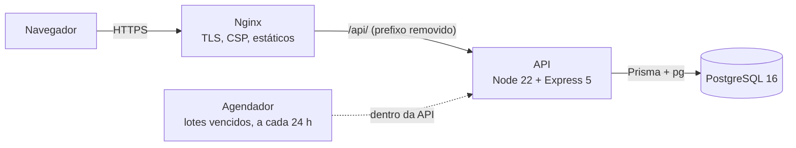

<div align="center">

# StockFlow v3.0

**Gestão de estoque com rastreabilidade por lote para a Arte Trigo.**


Projeto Integrador · UniEVANGÉLICA · 2026

</div>

## Sumário

- [Visão geral](#visão-geral)
- [Funcionalidades](#funcionalidades)
- [Arquitetura](#arquitetura)
- [Início rápido: demonstração](#início-rápido-demonstração)
- [Desenvolvimento](#desenvolvimento)
- [Testes e verificações](#testes-e-verificações)
- [Estrutura do repositório](#estrutura-do-repositório)
- [Perfis e permissões](#perfis-e-permissões)
- [Segurança e decisões de projeto](#segurança-e-decisões-de-projeto)
- [Documentação](#documentação)
- [Equipe](#equipe)

## Visão geral

O StockFlow controla o estoque de uma indústria de alimentos por **lote**: cada entrada, saída, transferência, ajuste e contagem de inventário é uma movimentação transacional, com saldo anterior e posterior gravados, e cada lote pode ser rastreado da primeira à última movimentação. A regra de negócio vive no servidor e no banco; o frontend apenas espelha as permissões.

## Funcionalidades

- **Lotes e produtos:** cadastro, bloqueio e desbloqueio com motivo, associação de etiqueta (QR Code ou RFID) e leitura por leitor que digita como teclado ou por Web Serial.
- **Mapa do armazém:** posições agrupadas por corredor e nível, com os lotes armazenados em cada uma.
- **Movimentações:** entrada, saída, transferência e ajuste de estoque, com saldo validado dentro da transação; a saída de lote vencido ou bloqueado é recusada também por uma trigger do banco.
- **Inventário:** contagem pendente que só altera o saldo quando um administrador a finaliza, com a divergência calculada.
- **Vencimentos e alertas:** lotes que vencem em até 30 dias, exportação em CSV e marcação automática de lotes vencidos por um agendador.
- **Rastreabilidade:** linha do tempo completa de cada lote, com busca pelo número do lote ou pela etiqueta.
- **Auditoria imutável:** triggers registram autor e IP das operações em lotes, movimentações e usuários, e a aplicação não tem permissão para alterar ou apagar o log.
- **Perfis:** Operador e Administrador, com a autoridade no backend.
- **Dashboard:** indicadores e gráficos em **SVG puro**, sem biblioteca de gráficos.
- **Login com cena 3D em CSS:** o armazém animado da tela de entrada é CSS puro e respeita `prefers-reduced-motion`.

## Arquitetura



O Nginx serve o frontend (React, Vite) e repassa `/api/` à API sem o prefixo, sobrescrevendo `X-Forwarded-For` com o endereço real. Na demonstração, só as portas 8443 (HTTPS) e 8080 (redireciona para HTTPS) são publicadas; a API e o banco não expõem porta. O agendador roda dentro do processo da API e só liga com `AGENDADOR_ATIVO=true`, para uma única réplica.

| Camada | Tecnologia | Versão |
| --- | --- | --- |
| Frontend | React e React DOM | 19.3.1 |
| | React Router | 7.18.5 |
| | Vite | 8.3.8 |
| | TypeScript | 5.9.3 |
| API | Node.js (imagem `node:22.20.0-bookworm-slim`; `engines` `>=22.18`) | 22.20.0 |
| | Express | 5.3.0 |
| | Prisma e `@prisma/adapter-pg` | 7.10.1 |
| | `express-validator` | 7.3.2 |
| | `express-rate-limit` | 8.7.4 |
| | `jose` (JWT HS256, 8 h) | 6.2.17 |
| | `bcrypt` | 6.0.0 |
| | TypeScript | 5.9.3 |
| Banco | PostgreSQL (imagem `postgres:16.10`) | 16.10 |
| Servidor web | Nginx (imagem `nginx:1.28.0-alpine`) | 1.28.0 |

O frontend não usa biblioteca de UI, de gráficos, de formulários, de estado nem de datas. Saldos e quantidades são `NUMERIC` no banco e trafegam como texto.

## Início rápido: demonstração

Pré-requisitos: Docker, `openssl` e um shell bash (no Windows, Git Bash).

```bash
./deploy/subir.sh      # gera deploy/.env e o certificado local, constrói e sobe tudo
./deploy/derrubar.sh   # derruba os serviços e mantém os dados
```

Abra `https://localhost:8443`; o certificado é autoassinado, então aceite a exceção do navegador. Na demonstração, a tela de login oferece atalhos para entrar com as credenciais abaixo.

Credenciais **de demonstração** (dados fictícios, publicados de propósito; não são segredos):

| Perfil | E-mail | Senha |
| --- | --- | --- |
| Administrador | `carlos.matos@stockflow.demo` | `Admin@Demo2026` |
| Operador | `joao.almeida@stockflow.demo` | `Operador@Demo2026` |

A lista completa de usuários, o conteúdo dos dados e as verificações estão em [`deploy/README.md`](deploy/README.md). Há um roteiro de apresentação de 10 minutos em [`docs/ROTEIRO_APRESENTACAO.md`](docs/ROTEIRO_APRESENTACAO.md).

## Desenvolvimento

Em ordem, a partir da raiz do repositório:

**1. Banco de desenvolvimento** (Compose da raiz, volume `pgdata`, porta 5433 só em `127.0.0.1`):

```bash
cp .env.example .env     # defina POSTGRES_PASSWORD e APP_DB_PASSWORD
docker compose up -d
```

Detalhes, o seed opcional de desenvolvimento e como recriar o banco estão em [`database/postgres/README.md`](database/postgres/README.md).

**2. API** (primeiro terminal):

```bash
cp backend/.env.example backend/.env     # preencha DATABASE_URL, JWT_SECRET, PORT e AGENDADOR_ATIVO
cd backend
npm ci
npm run generate                         # gera o cliente Prisma em src/generated (ignorado no Git)
npm run dev                              # API em http://localhost:3000
```

`DATABASE_URL` e `JWT_SECRET` (mínimo de 32 caracteres) são obrigatórios: a API recusa subir sem eles. `DATABASE_URL` usa o papel `stockflow_app` na porta 5433. `PORT` e `AGENDADOR_ATIVO` são opcionais. Veja [`backend/README.md`](backend/README.md).

**3. Frontend** (segundo terminal):

```bash
cd frontend
npm ci
npm run dev                              # http://localhost:5173, com proxy de /api para a API
```

O frontend chama sempre `/api/...`; o proxy do Vite remove o prefixo, como o Nginx faz na demonstração.

## Testes e verificações

| Comando | O que faz |
| --- | --- |
| `cd backend && npm test` | 313 testes (312 passam, 1 é ignorado de propósito), **contra o banco de desenvolvimento**: criam e alteram dados com prefixos próprios; não rode contra um banco que precise ser preservado. |
| `cd backend && npm run test:isolado` | Mesma suíte em um PostgreSQL descartável (`postgres:16.10`, dados em memória, porta livre em `127.0.0.1`, removido ao terminar): 312 + 1 testes, cerca de 25 a 30 s. Não precisa de `backend/.env` nem toca nos outros bancos. Exige Docker e bash. |
| `cd frontend && npm test` | 242 testes de lógica pura. |
| `./deploy/fumaca.sh` | Teste de fumaça contra a demonstração de pé. **Escreve** na demonstração: use só quando isso for esperado. |
| `./deploy/verificar.sh` | Verifica as invariantes de saldo e as contagens no banco da demonstração, sem alterar dados persistentes. |

O que o `test:isolado` faz e o que ele não toca estão em [`backend/README.md`](backend/README.md).

## Estrutura do repositório

```
backend/            API (Node, Express, Prisma), testes e README técnico
frontend/           Aplicação React, testes e README técnico
database/postgres/  Esquema, triggers, papéis e índices (init), seed de desenvolvimento e README
deploy/             Compose da demonstração, Nginx, dados de demonstração e scripts
docs/               Especificação v3.0 (PDF), roteiro de apresentação e ponteiro do manual
stockflow-api/  stockflow-frontend/  database/*.sql   protótipo anterior (fora da v3)
```

O protótipo anterior continua no repositório, mas não faz parte da v3.

## Perfis e permissões

| Área | Operador | Administrador |
| --- | --- | --- |
| Dashboard, Produtos, Lotes, Mapa, Histórico, Rastreabilidade, Vencimentos | sim | sim |
| Entrada, saída, transferência e registro de contagem de inventário | sim | sim |
| Finalizar e cancelar contagem de inventário | não | sim |
| Ajuste de estoque | não | sim |
| Usuários | não | sim |
| Auditoria | não | sim |
| Exportar vencimentos (CSV) | não | sim |
| Meu Perfil (dados e troca da própria senha) | sim | sim |

O backend é a autoridade: o menu, as rotas e os botões do frontend só espelham essas regras.

## Segurança e decisões de projeto

- **Decimais como texto.** Quantidades e saldos não passam por `parseFloat`; o frontend usa `BigInt` para somar, subtrair e comparar.
- **Dia operacional.** O "hoje" das regras de negócio é a função SQL `hoje_operacional()`, que devolve a data em `America/Sao_Paulo`; vale para a trava de saída por validade, para o agendador, para os alertas e para as janelas do dashboard, independentemente do fuso do servidor ou da sessão. Histórico e Auditoria continuam filtrando e exibindo em UTC, e as telas rotulam isso.
- **Escritas nunca são repetidas sozinhas.** Envio único; resposta desconhecida manda conferir o Histórico; conflito de saldo recarrega e pede nova confirmação.
- **Listas grandes.** Auditoria, Histórico e Rastreabilidade usam cursor do servidor, e a tela renderiza no máximo 300 itens.
- **Auditoria imutável.** Triggers gravam em `auditoria_log` o autor (`app.user_id`) e o IP (`app.ip`) só de `lote` (inserção, alteração e exclusão), `movimentacao` (inserção e mudança de status) e `usuario` (inserção e alteração); produto, localização e identificação não geram auditoria própria. As ações do agendador (`executarComoSistema`) ficam com usuário e IP nulos e aparecem como "Sistema". O papel da aplicação não tem permissão para alterar ou apagar o log.
- **Sessão e navegador.** JWT de 8 h guardado só em `sessionStorage`; nenhum HTML vindo da API é renderizado como HTML; CSP restrita (`default-src 'self'`), HSTS e demais cabeçalhos no Nginx; limite de tentativas no login.
- **Banco.** A aplicação usa um papel com privilégios mínimos (`stockflow_app`).
- **Gráfico de saldo por categoria, em kg.** Produtos em kg entram direto; `un`, `cx`, `rolo` e `pct` são multiplicados por `peso_unitario_kg`; litros, outras unidades e produtos de contagem sem peso ficam de fora, e o painel mostra quantos lotes ficaram de fora.
- **Limites conhecidos.** O leitor por Web Serial (Chromium, em HTTPS ou `localhost`) não foi testado com um leitor físico. O certificado da demonstração é autoassinado; em produção deve ser substituído por um emitido por uma autoridade confiável. As credenciais da demonstração ficam dentro do JavaScript do frontend quando o modo de demonstração está ligado; por isso só existem dados fictícios nele.
- **Documentos antigos.** `ARCHITECTURE.md`, `DEPLOYMENT_GUIDE.md`, `SECURITY.md`, `TECH_STACK.md` e `USER_MANUAL.md` já foram atualizados para a v3. `AUDIT.md` e `PROJECT_MEMORY.md` são registros históricos do protótipo anterior (2026-05-31) e estão marcados como tal.

Detalhes de segurança: [`SECURITY.md`](SECURITY.md).

## Documentação

- [`API_DOCUMENTATION.md`](API_DOCUMENTATION.md): rotas, perfis e convenções da API.
- [`ARCHITECTURE.md`](ARCHITECTURE.md): arquitetura da v3.
- [`TECH_STACK.md`](TECH_STACK.md): tecnologias e versões.
- [`SECURITY.md`](SECURITY.md): segurança.
- [`DEPLOYMENT_GUIDE.md`](DEPLOYMENT_GUIDE.md): implantação.
- [`USER_MANUAL.md`](USER_MANUAL.md): manual do usuário, tela por tela.
- [`backend/README.md`](backend/README.md): contratos detalhados e decisões da API.
- [`frontend/README.md`](frontend/README.md): estrutura, decisões, limites e testes do frontend.
- [`database/postgres/README.md`](database/postgres/README.md): banco de desenvolvimento.
- [`deploy/README.md`](deploy/README.md): demonstração em Docker.
- [`docs/ROTEIRO_APRESENTACAO.md`](docs/ROTEIRO_APRESENTACAO.md): roteiro de 10 minutos.
- [`docs/StockFlow_Especificacao_v3.0.pdf`](docs/StockFlow_Especificacao_v3.0.pdf): especificação.

## Equipe

| | Integrante |
|---|---|
| 👤 | Gustavo |
| 👤 | Pedro |
| 👤 | Rayk |
| 👤 | Vinicius |

---

<div align="center">

© 2026 Arte Trigo · StockFlow · Todos os direitos reservados

</div>
